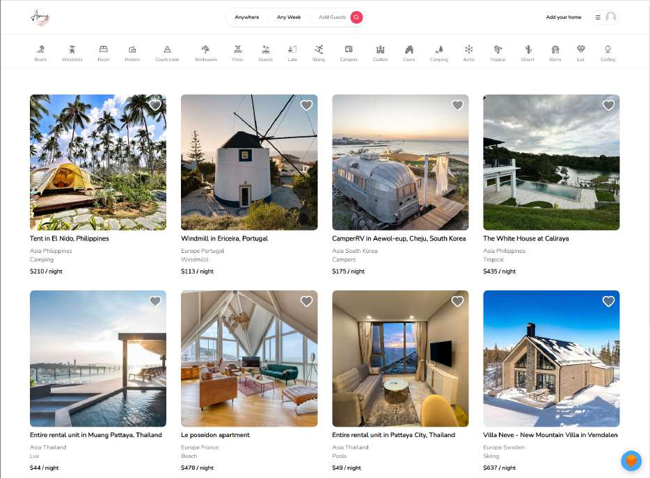
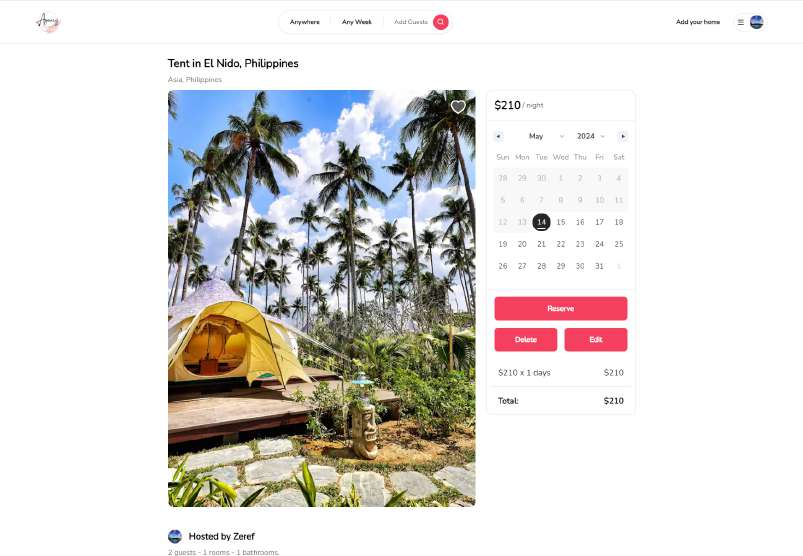
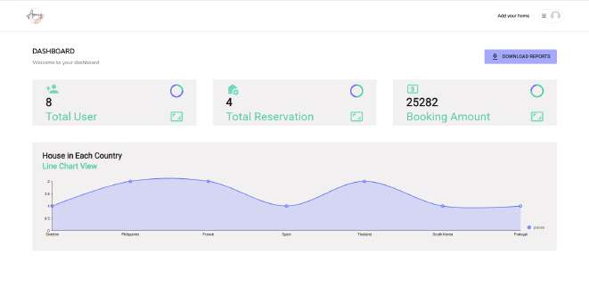

# Booking & Reservation System

A full-stack property rental and reservation web application built with React, Node.js, Express, and MongoDB. Users can browse, filter, list, and book properties with Stripe payments, while administrators can monitor platform metrics and manage users, listings, and reservations.

## Tech Stack

- **Frontend:** React 18 (Vite), Tailwind CSS, Material UI, Zustand, React Router v6, React-Leaflet, Nivo Charts
- **Backend:** Node.js, Express, MongoDB (Mongoose), JWT, Passport.js (Google OAuth 2.0), AES-256 Encryption
- **Third-Party Services:** Stripe (payments, invoices, refunds), Cloudinary (image hosting)

## Features

- **Authentication & Authorization:** Email/password registration and login, Google OAuth 2.0, JWT access/refresh token rotation, and role-based access control (`user`, `admin`).
- **Property Management:** Create, edit, and delete rental listings with multi-step forms, Cloudinary image uploads, geographic coordinates, and amenity selection.
- **Search & Discovery:** Filter listings by category, country, date range, guest/room capacity, price, and amenities.
- **Reservations & Payments:** Date-range booking validation, Stripe Checkout integration, automated invoice generation, and reservation cancellation with refunds.
- **User Dashboard:** Manage favorite properties, view upcoming/past trips, and update profile credentials.
- **Admin Dashboard:** View platform statistics (total users, reservations, revenue), country-level listing distribution charts, and manage all users, listings, and bookings.

## Screenshots

### Home Page


### Listing Details & Booking Calendar


### Admin Dashboard


## Getting Started

1. **Clone the repository:**
   ```bash
   git clone <repository-url>
   cd Booking-Reservation-system-Forked
   ```

2. **Start the backend (`http://localhost:3000`):**
   Configure your environment variables in `server/.env`, then run:
   ```bash
   cd server
   npm install
   npm run dev
   ```

3. **Start the frontend (`http://localhost:5173`):**
   ```bash
   cd client
   npm install
   npm run dev
   ```

